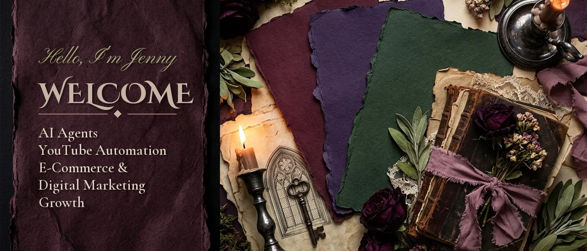

I turn AI, YouTube automation and digital marketing into repeatable workflows. This is where I share the Claude skills and tools I use day to day.

## What I work on

- **AI Agents**: Claude Code workflows with sub-agents and built-in review steps
- **YouTube Automation**: an end-to-end pipeline from idea to script, visuals and edit
- **E-Commerce & Digital Marketing**: store, content and ad workflows
- **Growth**: experiments, measurement, fast learning

## How I work

- Always act on data.
- Measure everything that can be counted with code.
- Have every task checked by an independent reviewer.
- For strong design, always give examples and choose by instinct.
- Personalize your AIs and create your own AI agents.
- Never sign off on anything without human approval.
- Small test first, then scale.

## What you'll find here

| Topic | Contents |
|---|---|
| AI | Agent design, prompt patterns, skills |
| YouTube | Production-pipeline skills, niche research methods |
| Marketing | E-commerce and growth workflows |

Repositories are added over time. Each one solves a single problem and can be copied and used as is.

## Tools

Claude Code, ChatGPT, Gemini, NotebookLM, Google Flow, Obsidian, Python

## Connect

[LinkedIn](https://www.linkedin.com/in/esra-caglar-profile), or open an issue on any of my repositories.
